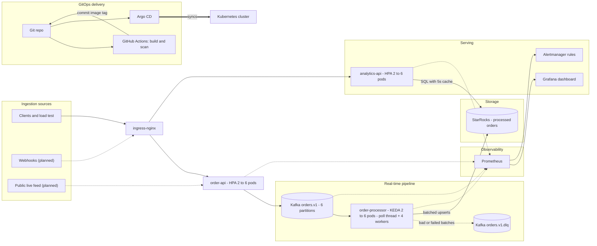

# StreamPulse

A real-time order-event platform built the way a production platform team would run it: three Java microservices, Kafka, StarRocks, Kubernetes with HPA and KEDA, GitOps with Argo CD, and a Prometheus/Grafana stack that shows pod health, application health, performance and failures on one dashboard.

Orders flow in over REST, land on Kafka, are batch-written into StarRocks by a multi-threaded consumer, and are served back as live analytics. Everything except the first bootstrap command is deployed by `git push`.

## What StreamPulse is, in plain words

StreamPulse is the "back office" of an online store, built to keep working when thousands of orders arrive at once. Orders come in over the internet, wait in a safe line so none are lost, get saved by background workers, and show up on a live dashboard. When traffic grows it adds workers automatically, and when something breaks it raises an alert. A change pushed to Git deploys itself.

It does not sell anything. It is the platform that handles the orders, built the way a production team would run it, to demonstrate Kubernetes, Kafka, StarRocks, GitOps and observability skills.

## Requirements and architecture (issue #1)

### 1. Core functional requirements

#### 1.1 Data ingestion sources

| Source | Status | Notes |
|---|---|---|
| REST API (`POST /api/orders`) | Built (v1) | Validates the order, publishes to Kafka, answers 202 after the broker acknowledges it |
| Bulk load generator (`POST /api/orders/bulk`) | Built (v1) | Synthetic orders for demos and load tests |
| Webhooks | Planned | Same endpoint pattern with a signature check, for example from a payment provider |
| IoT or public live feed | Planned | Small feeder service that turns a public stream into Kafka events |
| User input via a UI | Out of scope (v1) | Orders come from API clients, not a form |

**Event contract:** JSON with `eventId`, `orderId`, `customerId`, `region`, `category`, `amount`, `status`, `createdAt`. Events are keyed by `customerId`, so one customer's events stay in order.

#### 1.2 Data processing pipeline

- **Real-time (built):** a Kafka consumer writes events in small batches (500 events or 500 ms, whichever comes first). It uses 1 poll thread and 4 worker threads, keeps ordering per partition, applies backpressure through bounded queues, and commits offsets only after the database write succeeds.
- **Failure handling (built):** unparseable events and batches that keep failing go to a dead-letter topic (`orders.v1.dlq`) and can be replayed.
- **Delivery guarantee:** at-least-once delivery plus an idempotent database write (primary key on `order_id`), which behaves as effectively exactly-once.
- **Batch processing (planned):** scheduled rollups such as hourly or daily revenue using StarRocks materialized views. v1 is streaming only.

#### 1.3 Storage layer

| Data | Where | Retention |
|---|---|---|
| Raw events | Kafka topic `orders.v1` (6 partitions) | 7 days |
| Failed events | Kafka topic `orders.v1.dlq` | 14 days |
| Processed data | StarRocks table `orders_events` (latest state per order) | Kept until pruned |
| User metadata | Not stored in v1; only `customerId` appears on events | A users table is planned if accounts are added |
| Platform configuration | Git (Kubernetes manifests, Argo CD, alert rules, dashboard JSON) | Full history |
| Metrics | Prometheus | 6 hours in dev |

#### 1.4 Client / frontend interface

- **Dashboard (built):** one Grafana dashboard covering pod health, restarts, latency, consumer lag, scaling, StarRocks write time and JVM health.
- **Alerts (built):** 12 Prometheus alert rules, each with an entry in [docs/RUNBOOK.md](docs/RUNBOOK.md).
- **Analytics API (built):** `/summary`, `/revenue-by-region`, `/top-categories`, `/orders-per-minute`.
- **Business UI (planned):** a small web page that charts the analytics API.

### 2. Non-functional requirements

The targets below are goals to be measured, not results. Issue 13 records the measured numbers.

#### 2.1 Scalability

- **APIs:** HPA on CPU (60% target), 2 to 6 pods locally and 3 to 12 in the cloud overlay.
- **Consumer:** KEDA on Kafka consumer lag (one replica per 500 messages of lag), 2 to 6 pods. The ceiling is the partition count, because extra consumers would sit idle.
- **Kafka and StarRocks:** single node in dev. Production would use 3 brokers with replication factor 3 and multiple StarRocks backends.
- **Traffic spikes:** Kafka absorbs bursts, so the API never waits on the database.

#### 2.2 Latency (targets)

| Path | Target | Alert threshold |
|---|---|---|
| `order-api` p95 | under 300 ms | over 1 s for 5 min |
| Event published to visible in analytics | under 10 s (500 ms flush + 5 s cache) | n/a |
| StarRocks batch write p95 | under 1 s | over 2 s for 10 min |
| Consumer lag after a spike | drains back to near 0 | over 20k for 10 min |

#### 2.3 Security

| Area | v1 (built) | Planned |
|---|---|---|
| Containers | Non-root, read-only filesystem, all capabilities dropped, restricted Pod Security Standard | Signed images (Cosign) |
| Supply chain | Trivy image scan in CI (report only) | Gate releases on critical findings |
| Secrets | Dev-only Kubernetes Secret | External Secrets with a vault |
| API authentication and authorization | Not implemented | OAuth2/JWT (for example Keycloak), with roles for read vs write |
| Encryption in transit | Not implemented (plain inside the cluster) | TLS at ingress (cert-manager), Kafka TLS + SCRAM, StarRocks TLS |
| Encryption at rest | Depends on the storage class | Encrypted volumes in the cloud |
| Network | Open inside the cluster | Default-deny NetworkPolicies |
| Deployment access | Argo CD AppProject limits sources and destinations | SSO and RBAC for Argo CD and Grafana |

### 3. System architecture diagram



### 4. Project board plan

Columns: `Backlog` > `Ready` > `In progress` > `In review` > `Done`. Labels: `infra`, `backend`, `observability`, `gitops`, `security`, `docs`.

| # | Task | Label | Done when |
|---|---|---|---|
| 1 | Requirements and architecture diagram | docs | This section is merged into the README |
| 2 | Repo scaffold: Maven multi-module, `common` event contract | backend | `mvn verify` passes in CI |
| 3 | `order-api`: REST ingestion and Kafka publisher | backend | A POST returns 202 and the event appears on `orders.v1` |
| 4 | `order-processor`: multi-threaded consumer and StarRocks writer | backend | Unit tests pass; offsets commit only after writes |
| 5 | `analytics-api`: queries with a 5-second cache | backend | All four endpoints return live data |
| 6 | Dockerfile and image build for all three services | infra | `docker build` works; image runs as non-root |
| 7 | Local cluster (kind), ingress and metrics-server | infra | `kubectl get nodes` is healthy; `*.localtest.me` resolves |
| 8 | Kafka (Strimzi) and StarRocks with schema job | infra | Topic and `orders_events` table exist after sync |
| 9 | Kubernetes manifests: probes, security context, PDBs, HPA and KEDA | infra | Pods Ready; scaling works under load |
| 10 | Argo CD app-of-apps with sync waves | gitops | One `kubectl apply` brings up the whole platform |
| 11 | CI pipeline: test, validate manifests, build, scan, tag bump | gitops | Push to `main` rolls out a new version with no manual step |
| 12 | Observability: Prometheus rules, Grafana dashboard, runbook | observability | Dashboard shows live data; an alert fires in a drill |
| 13 | Load test and record real numbers against the targets in 2.2 | observability | Results table with screenshots |
| 14 | Failure drills: kill a pod, poison message, StarRocks outage | observability | Runbook steps confirmed |
| 15 | Security v2: API authentication, TLS, NetworkPolicies, External Secrets | security | Unauthenticated requests are rejected |
| 16 | Live data feed (public stream adapter) | backend | Real events visible on the dashboard |
| 17 | Demo recording, README polish, LinkedIn post | docs | Public repo with architecture diagram, demo video and numbers |

## What is verified and what is not

I built this in a sandbox with no Kubernetes cluster and no access to Maven Central, so be clear about what has been run:

| Item | Status |
|---|---|
| `PartitionedBatchProcessor` (the multi-threaded core) | Compiled with `javac -Xlint:all` and exercised with a smoke harness: per-partition ordering, offset commits, retry then dead-letter, marker records, drain on close. The smoke run found and fixed a real shutdown-latency bug. |
| JUnit tests for that class | Written, run by CI (`mvn verify`). |
| Spring Boot services (controllers, consumer loop, repository) | Written carefully but **not compiled here**. CI compiles them on the first push; expect to fix a typo or two. |
| All YAML (Kubernetes, Argo CD, kind, CI) and the dashboard JSON | Parsed, and cross-checked (selectors, names, ports, image refs, Argo sources vs project allow-list). |
| Docker images, cluster deployment, autoscaling, dashboards | **Not run here.** Follow the quickstart; the first full sync is where version-specific surprises show up. |

Things to confirm on first run (I could not read these docs from the sandbox): the Strimzi chart range `0.45.*` with Kafka `3.9.0`, the KEDA chart `2.17.*`, and the StarRocks FE service name `kube-starrocks-fe-service` (`kubectl -n starrocks get svc`). If one is wrong, it is a one-line change in `argocd/apps/` or `k8s/base/config.yaml`.

## Quickstart (local, kind)

Prerequisites: Docker (8 CPU / 16 GB), `kind`, `kubectl`, a GitHub account, ports 80/443 free.

```bash
# 1. Point the manifests at your GitHub account and push (public repo, branch main)
scripts/set-repo.sh <your-github-username>
git init -b main && git add -A && git commit -m "StreamPulse"
git remote add origin https://github.com/<your-github-username>/streampulse.git && git push -u origin main

# 2. Bootstrap: kind cluster + images + Argo CD + app-of-apps
make bootstrap

# 3. Watch Argo CD install everything (10-20 min the first time)
kubectl -n argocd get applications -w
```

Then:

| What | How |
|---|---|
| Argo CD UI | `make argocd` then https://localhost:8080 (user `admin`, password printed by bootstrap) |
| Grafana | `make grafana` then http://localhost:3000 (`admin` / `admin`), dashboard **StreamPulse - Platform Health** |
| Send one order | `curl -X POST http://order-api.localtest.me/api/orders -H 'content-type: application/json' -d '{"customerId":"c1","region":"APAC","category":"toys","amount":19.99}'` |
| Live analytics | `curl http://analytics.localtest.me/api/analytics/summary?minutes=60` |
| Everything's status | `make status` |

For a real cluster (AKS/EKS/GKE): change `path` in `argocd/apps/09-streampulse.yaml` to `k8s/overlays/cloud`, drop `--kubelet-insecure-tls` from metrics-server, and replace the ingress-nginx values with a normal LoadBalancer Service. CI then builds images to GHCR and commits the new tags.

## Demo script (the 10-minute interview version)

1. `make status`: everything Healthy/Synced in Argo CD.
2. `scripts/load-test.sh`: pushes ~800k orders.
3. In Grafana, watch **consumer lag** rise, then **KEDA scale `order-processor` from 2 to 6** and lag drain. Watch `order-api` scale on CPU via HPA.
4. `scripts/chaos.sh kill order-processor`: a pod dies, the PDB and Deployment keep serving, no data lost.
5. `scripts/chaos.sh poison`: a malformed message goes to the DLQ, an alert fires, the pipeline never stalls.
6. Change `STREAMPULSE_PROCESSOR_BATCH_SIZE` in `k8s/base/order-processor.yaml`, `git push`, and watch Argo CD roll it out with no manual step. That is the GitOps story.

## Key design decisions (good interview answers)

- **HPA for the APIs, KEDA for the consumer.** HTTP services scale on CPU. A Kafka consumer's real load signal is lag, which CPU does not show. KEDA creates and owns the HPA for the processor; you must never define a second HPA for the same Deployment. `maxReplicaCount` is 6 because more consumers than partitions sit idle.
- **Deployments omit `replicas`** and Argo CD has `ignoreDifferences` on `/spec/replicas`, otherwise self-heal and the autoscalers fight each other.
- **At-least-once + idempotent sink = effectively exactly-once.** Offsets are committed only after StarRocks accepted the batch. StarRocks `PRIMARY KEY (order_id)` turns re-delivered inserts into upserts.
- **Per-partition ordering without locks.** Each worker thread owns bounded queues; partition `p` always goes to worker `p mod N`. Bounded queues are the backpressure boundary.
- **Cooperative rebalancing** (`CooperativeStickyAssignor`) so KEDA scaling does not stop the world; on revoke the consumer flushes in-flight batches and commits before ownership moves.
- **Dead-letter topic** for unparseable messages and batches that fail after retries; the pipeline never blocks on one bad record.
- **Graceful shutdown end to end**: `preStop` sleep for endpoint drain, `server.shutdown=graceful`, a 90s termination grace period for the consumer to flush and commit.
- **Security baseline**: non-root numeric UID, read-only root filesystem, all capabilities dropped, seccomp, `restricted` Pod Security Standard on the namespace, an Argo CD AppProject limiting sources and destinations, Trivy scan in CI.
- **GitOps boundary**: CI builds and commits an image tag; only Argo CD touches the cluster.

## Observability

One Grafana dashboard (6 sections, 24 panels, generated by `tools/gen_dashboard.py`): ready pods and restarts, consumer lag (total and per partition), events/s, HTTP error ratio and p95/p99 latency, replica counts for HPA and KEDA, CPU and memory per pod, StarRocks write latency, worker queue depth, failures and dead letters, JVM heap/GC/threads, DB connection pool, and firing alerts.

Twelve alert rules (`k8s/platform/monitoring/prometheus-rules.yaml`) cover crash loops, unavailable deployments, memory near limit, autoscaler at max, error rate, p95 latency, publish failures, high or stalled lag, StarRocks write failures, dead letters, and slow batch flushes. See `docs/RUNBOOK.md` for what to do when each fires.

## Phase 2: advanced upgrades worth adding next

| Idea | Tool | Why it impresses |
|---|---|---|
| Canary / blue-green with automatic rollback on SLO breach | Argo Rollouts + Prometheus analysis | Progressive delivery, not just rolling updates |
| Automatic image promotion without CI commits | Argo CD Image Updater | Fewer moving parts in CI |
| Distributed tracing across API, Kafka and consumer | OpenTelemetry + Tempo/Jaeger | Debug latency across async hops |
| Centralised logs correlated with metrics | Loki + Promtail/Alloy | Full observability trio |
| Secrets without secrets in Git | External Secrets Operator + Vault / Azure Key Vault | Replaces the dev-only Secret |
| Admission policy as code | Kyverno or OPA Gatekeeper | Enforce limits, signed images, no `latest` |
| Image signing and SBOM | Cosign + Syft, verified by Kyverno | Supply-chain security |
| Zero-trust networking | Default-deny NetworkPolicies, then Cilium or Istio mTLS | Real security posture |
| Infrastructure as code for the cluster | Terraform for AKS/EKS + Karpenter or cluster-autoscaler | Node-level scaling to complement pod scaling |
| Higher-throughput ingestion | StarRocks Stream Load or Routine Load instead of JDBC batches | Biggest single throughput win |
| Faster analytics | StarRocks materialized views for per-minute rollups | Sub-100ms dashboards |
| Repeatable performance numbers | k6 load tests in CI with thresholds | Replaces the bash load script, gives you real figures |
| Resilience testing | Chaos Mesh or Litmus experiments | Proves the runbook works |
| Multi-environment | Argo CD ApplicationSet (dev/stage/prod) | One definition, many clusters |
| Cost visibility | OpenCost / Kubecost | FinOps story |

## Repo layout

```
services/            Maven multi-module (common, order-api, order-processor, analytics-api) + one Dockerfile
k8s/base/            Deployments, Services, HPA, KEDA ScaledObject, PDBs, ServiceMonitors, Ingress
k8s/overlays/        local (kind, images loaded locally) and cloud (GHCR tags bumped by CI)
k8s/platform/        Kafka (Strimzi), StarRocks schema job, Prometheus rules + Grafana dashboard
argocd/              AppProject, root app-of-apps, 10 child Applications with sync waves
kind/ scripts/       local cluster, bootstrap, load test, chaos drills
.github/workflows/   test, manifest validation, image build + scan, GitOps tag bump
tools/               dashboard generator, repo validator (make validate)
docs/                runbook, LinkedIn/resume material
```

## Troubleshooting

- **Argo CD app stuck Progressing / OutOfSync on first run**: the retry policy handles CRD-ordering races; give it a few minutes, then `kubectl -n argocd describe application <name>`.
- **`order-processor` not ready**: its readiness includes the StarRocks connection. Check `kubectl -n starrocks get pods` and that the `starrocks-schema` PostSync job completed.
- **HPA shows `<unknown>` CPU**: metrics-server is not ready yet (`kubectl top nodes`).
- **Ingress hosts do not resolve**: `*.localtest.me` needs DNS access; otherwise add `127.0.0.1 order-api.localtest.me analytics.localtest.me` to `/etc/hosts`.
- **Out of memory on kind**: raise Docker to 16 GB, or lower the StarRocks BE memory in `argocd/apps/05-starrocks.yaml`.
